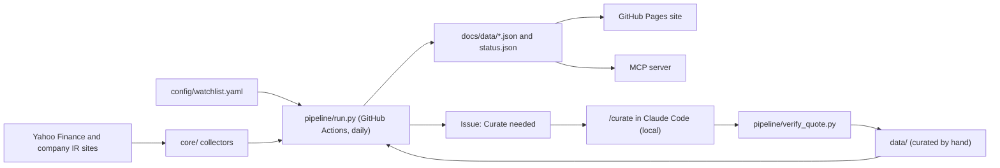

# Holdco Intel

A daily, public-source tracker of six advertising holding companies (Publicis, Omnicom, WPP, Havas, Dentsu and Stagwell), for anyone who follows the industry and wants their growth, margins, guidance and management's own words side by side.

**Live dashboard: [carsonstubstad.github.io/holdco-intel](https://carsonstubstad.github.io/holdco-intel/)**

Personal project built from public sources. Not affiliated with or endorsed by any company covered. Nothing here is investment advice.

## What you are looking at

One page, top to bottom:

- **Peer set**: pick companies and everything below follows; the link carries the selection.
- **What’s new**: results, guidance moves, capital markets days and deals from the last 14 days, then upcoming dates.
- **Peer table**: per company, organic growth and its change, margin, each beside its guidance, share moves and the next results date, ending with a **Key takeaway**.
- **Share price**: each company rebased to 100 against the S&P 500, one month to two years, with its own **Key takeaway**.
- **In their words**: management quoted verbatim by theme, with sources.
- **Press releases**: the last 30 days from each company's own site.
- **All guidance**: every current guidance record and its source.
- **Quarterly history**: organic growth over eight quarters.
- **Data health**: the last run and any failing source.
- **The printed handout**: a five-page meeting pack covering all six.

## Numbers

Generated 2026-10-28 by `python -m pipeline.stats`.

- Pipeline runs: 32
- Runtime: median 32.3 s, p95 37.5 s (nearest rank)
- Runs with every source ok: 25 of 32 (78%)
- Source failures across 32 daily snapshots: Dentsu press releases 6, Omnicom press releases 1; every other source: 0
- Curate commits: 9, the last on 26 Oct 2026
- Verified guidance records: 25
- Press release sources ok now: 6 of 6
- Price history: 525 trading days (7 Oct 2024 to 27 Oct 2026)

## Architecture



One shared Python library (`core/`) feeds three consumers: the daily pipeline, the static site and an MCP server that gives Claude the same data. Companies are defined in one place, `config/watchlist.yaml`. The JSON files in the repo are the database. See [docs/ARCHITECTURE.md](docs/ARCHITECTURE.md).

## How the daily pipeline works

A GitHub Actions workflow runs every day at about 22:30 UTC. `pipeline/run.py` fetches each source once: the latest closes from Yahoo Finance, and press releases and results calendars from each company's investor relations site. It copies the hand-curated files in `data/` into `docs/data/` as JSON, writes `status.json` with each source's health, validates every file against `schemas/` and commits `docs/data/` as the bot. GitHub Pages serves `docs/` as it is: one HTML file, one JS file, one CSS file and Plotly from a CDN, with no build step. A source that fails is logged in `status.json` and the run carries on, so one broken feed never takes the page down. When a flagged release (results, guidance, a deal) arrives, the workflow opens or updates a "Curate needed" issue. Prices move only on trading days.

## Why the LLM step is local

The only language model in this project is Claude Code, which I run by hand on my laptop with the /curate command. The daily pipeline never calls one. Cost: a model inside GitHub Actions needs an API key that can bill, and this project runs at zero cost. Trust: guidance, KPI figures and quotes are what readers rely on, so I read every draft before it is committed, and a script (pipeline/verify_quote.py) must find each quote word for word in the company's own document. Repeatability: the same inputs always produce the same page.

## Data sources and their limits

Everything is public and needs no login. Share prices come from Yahoo Finance through the yfinance library, which is unofficial and can miss a day; the header names any company whose last close falls two or more weekdays behind. Everything else comes from each company's own investor relations website: press releases, results calendars, results releases and, for quotes, documents on the company's own domain. No newswires, SEC filings or paid data. Limits: organic growth and margins are each company's own non-GAAP measures, defined differently, and periods differ, so compare with care. Dentsu publishes its results on a host that asks crawlers to stay out, so it shows half-year figures only and no guidance. A site redesign can break a feed; Data health shows it.

## Failures and fixes

Every source that did not behave as documented is logged in [docs/FAILURES.md](docs/FAILURES.md) with the date, the symptom and the fix. Three that shaped the design:

- **Google News RSS** (2026-10-06). Problem: its robots.txt disallows the RSS path. Fix: respected it; the news collector was parked, and press releases come only from each company's own site.
- **Havas market cap** (2026-10-06). Problem: about 10x too high, because the config held the pre-split share count while yfinance split-adjusts the price history (a 1:10 reverse split in November 2025). Fix: set the post-split share count.
- **Omnicom documents** (2026-10-15). Problem: links on investor.omc.com redirect to the IR vendor's file host, whose robots.txt answers 403 to everyone. Fix: under RFC 9309 a 4xx robots.txt means no rules, so the file is read, and each quote's source stays the omc.com link.

## Running it yourself

Python 3.12 with [uv](https://docs.astral.sh/uv/). No API keys or secrets.

```sh
uv sync                          # dependencies from pyproject.toml
make check                       # ruff and pytest
make pipeline                    # run the collectors; writes docs/data/*.json
git checkout -- docs/data        # discard that local run before committing
make serve                       # the site on http://localhost:8000
uv run python -m pipeline.stats  # the Numbers above
claude mcp add holdco -- uv run python -m mcp_server.server   # the MCP server in Claude Code
```
